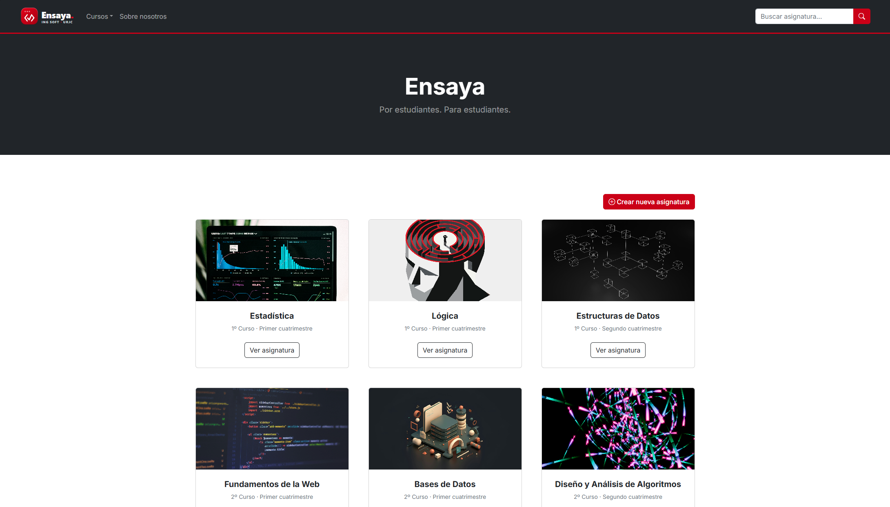
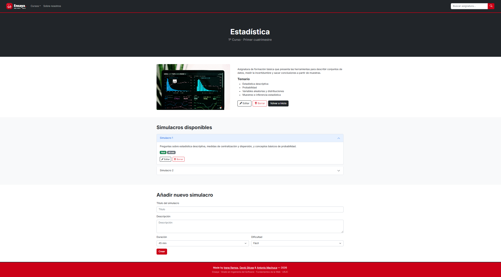
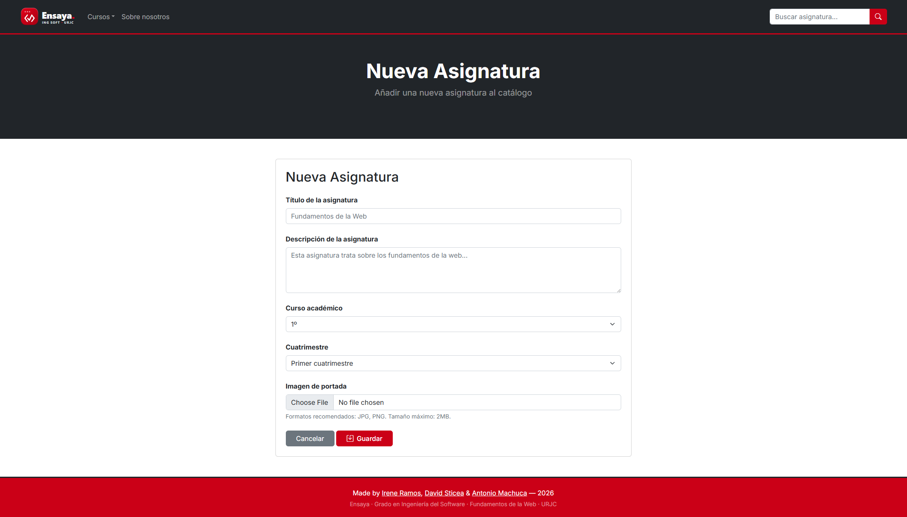

# Ensaya — Exam Simulation Platform

---

## Development Team

| Names| URJC Email | GitHub Account |
| :--- | :--- | :--- |
| **Irene Ramos Martínez-Campos** | `i.ramosm.2023@alumnos.urjc.es` | [@irenermc](https://github.com/irenermc) |
| **Antonio Manuel Machuca Hortelano** | `am.machuca.2023@alumnos.urjc.es` | [@antoniomachuca](https://github.com/antoniomachuca) |
| **David Sebastián Sticea Covaciu** | `ds.sticea.2023@alumnos.urjc.es` | [@David-2885](https://github.com/David-2885) |

---

## Team Coordination

* **Public Trello Board:** [https://trello.com/b/3T1RV9Hp](https://trello.com/b/3T1RV9Hp)  
  

---

## Functionality

**Ensaya** is a collaborative web platform designed by and for Software Engineering students at Universidad Rey Juan Carlos (URJC). The application allows students to prepare for official university exams through curated course catalogs and realistic, interactive test simulations.

### Entities

The application manages a hierarchical domain model structured around a **Primary Entity** and a **Secondary Entity**:

#### 1. Primary Entity: `Subject` (*Asignatura*)
The core entity represents an academic subject belonging to the Software Engineering degree curriculum. It serves as the primary container for study resources, course metadata, and related exam simulations.

* **Attributes:**
  * `name`: Official title / name of the subject (must be unique).
  * `description`: Comprehensive syllabus overview, competencies, and description.
  * `courseYear`: Academic year within the degree (`1st Year`, `2nd Year`, `3rd Year`, `4th Year`).
  * `semester`: Term / semester (`1st Semester`, `2nd Semester`).
  * `image`: Representative cover image / banner visual for the subject card and detail view.
* **Associated Images:** **Yes**. Each subject record is linked to a cover image that visually represents the discipline in the catalog grid and detail headers.

#### 2. Secondary Entity: `Test` (*Simulacro de Examen*)
The secondary entity represents an exam simulation or test evaluation associated with a specific subject. Each subject can hold multiple tests corresponding to different exam sessions, partial assessments, or practice modules. Observe that $1$ Subject contains $N$ tests.

* **Attributes:**
  * `id`: Unique identifier of the test.
  * `subjectId`: Foreign key / reference linking the test to its parent `Subject`.
  * `title`: Title or session name of the exam simulation (e.g., *"Midterm Exam - Units 1 to 4"*).
  * `description`: Overview, topics covered, instructions, and rules for the test.
  * `difficulty`: Difficulty level (`Easy`, `Medium`, `Hard`).
  * `duration`: Recommended time limit in minutes (e.g., `45`, `60`, `90`).
  * `image`: Optional badge, topic thumbnail, or exam icon.
* **Associated Images:** **Optional**. Tests may include an illustrative icon, diagram, or difficulty badge.

---

### Search and Categorization

* **Search Engine:**
  * Free-text search matching the **Subject** name or title (as well as keywords in its syllabus description). The search bar allows students to quickly locate any course in the curriculum.
* **Categorization and Filtering:**
  * **Academic Year:** Quick filters by degree progression (`1st Year`, `2nd Year`, `3rd Year`, `4th Year`).
  * **Semester / Term:** Filtering by study period (`1st Semester`, `2nd Semester`).
  * **Test Difficulty & Type (Detail Level):** Inside each subject view, simulations can be filtered by difficulty level and exam format.

---

## Design and Visual Identity

The web application adheres to the official **Universidad Rey Juan Carlos (URJC)** corporate visual identity:
* **Typography:** **Inter** (Google Fonts) as the primary digital typeface for legibility and modern hierarchy.
* **Color Palette:**
  * **URJC Red (Primary):** `#CB0017` (Pantone 485 C) — brand accents, call-to-action buttons, active navigation states.
  * **Dark Neutrals:** `#000000` / `#212529` — high-contrast typography, dark navigation headers, footers.
  * **Light Backgrounds:** `#FFFFFF` / `#F8F9FA` — clean card surfaces and readable content containers.
* **Layout:** Fully responsive multi-device design implemented with the **Bootstrap 5 (v5.2.3)** Grid System.

---

## Technical References

* **Base Template:** [Start Bootstrap - Shop Homepage](https://github.com/StartBootstrap/startbootstrap-shop-homepage) (customized and adapted for an academic course catalog and exam simulator).
* **UI Framework:** [Bootstrap 5.2.3](https://getbootstrap.com/) & [Bootstrap Icons](https://icons.getbootstrap.com/).
* **Data Sources:** Structured curriculum datasets located in `dataExamenes/`.

---

## Practice 1: Web Page Layout with HTML and CSS

### Screenshots

#### 1. Main Page (Subject catalog grid) 
Responsive catalog displaying the subjects in a 1-column (mobile), 2-column (tablet) or 3-column (desktop) grid using Boostrap. Each card shows the basic information of the main entity (subject name, cover image, academic year, and semester) along with a button to access its detail page. It also features an action button on the top-right to add a new subject

#### 2. Detail Page (Subject view & simulation management) 
Detailed view of a selected subject, showing its full information (title, academic year, semester, cover image, description, and syllabus) along with action buttons ("Edit", "Delete", and "Back to Home"). It also lists all related secondary entities (simulations) with individual "Edit" and "Delete" buttons, followed by a form to create and add a new simulation to the subject.

#### 3. New Subject Page (Primary entity creation form) 
Form page to create a new subject. It includes specific input fields for all its attributes (title, description, academic year, semester, and cover image upload), featuring action buttons to either save the new item or cancel and return to the main catalog.

### Team Participation

#### Irene Ramos Martínez-Campos

**Tasks performed:**

* Design and complete implementation of the subject detail view across 5 subjects (`detalle-*.html`), including syllabus, primary entity action buttons, secondary entity list (exam simulations accordion with individual edit/delete actions), and the new simulation creation form.
* Initial HTML structural layout of the main landing page (`index.html`) using Bootstrap Grid.
* Adaptation of the catalog cards to domain entities with course, semester, difficulty, and duration metadata, connecting each card to its detail page.
* Custom CSS styling for card covers and header images (`object-fit: cover`) to ensure responsive design and prevent image deformation.

**Most significant commits:**

1. [73cfd01 - Update catalog cards to subjects with course, semester and links to detail pages](https://github.com/CodeURJC-FW-2026-27/webapp21/commit/73cfd011a9d0bb17f3f85c52b5004c57e7b2e179): Refactored main catalog cards into primary entity subjects with course and semester badges, establishing direct navigation links to each subject detail view.
2. [d9feebc - Add subject detail pages with intro, syllabus, simulacros and new simulacro form](https://github.com/CodeURJC-FW-2026-27/webapp21/commit/d9feebc829985909e622ae58e00fc0a645ff3292): Implemented five subject detail pages featuring all primary entity attributes, action buttons (Edit, Delete, Back), related secondary entities (practice exam accordion with actions), and the new simulation form.
3. [b2ec581 - Add cover image styles for cards and detail pages](https://github.com/CodeURJC-FW-2026-27/webapp21/commit/b2ec5810be478e3260fa746c258d4f6c3604cfc2): Added responsive CSS styles in `custom.css` (`.card-img-top` and `.subject-cover`) ensuring consistent height and `object-fit: cover` to avoid image distortion across cards and detail headers.
4. [bdad554 - Add real example cards with subject, course, difficulty and duration](https://github.com/CodeURJC-FW-2026-27/webapp21/commit/bdad5542b092ede6ed72142f8b0c6f130aa17b49): Adapted the base template catalog to the academic platform domain, replacing e-commerce items with exam simulations including course, semester, difficulty badges, and duration limits.
5. [c25e308 - Add cover images for the five subjects](https://github.com/CodeURJC-FW-2026-27/webapp21/commit/c25e308141bfb5df13126a81299831c67e6a2778): Added cover images for the initial subjects to visually represent the academic catalog cards and detail page headers.

**Files with the most participation:**

1. [index.html](https://github.com/CodeURJC-FW-2026-27/webapp21/blob/main/index.html): Built the initial HTML structural layout using the Bootstrap Grid System, adapted the academic course catalog cards with degree year, semester, difficulty badges and duration limits, and connected each card to its respective detail view.
2. [detalle-bases-datos.html](https://github.com/CodeURJC-FW-2026-27/webapp21/blob/main/detalle-bases-datos.html): Designed and implemented the complete detail view for *Bases de Datos* (shared architectural base with `detalle-estadistica.html` and `detalle-logica.html`), structuring syllabus competencies, entity action buttons, exam simulations accordion with individual actions, and the new simulation creation form.
3. [detalle-estructuras-datos.html](https://github.com/CodeURJC-FW-2026-27/webapp21/blob/main/detalle-estructuras-datos.html): Implemented the full subject detail page for *Estructuras de Datos*, including course overview, primary entity controls, related secondary entity practice exams list, and simulation creation inputs.
4. [detalle-fundamentos-web.html](https://github.com/CodeURJC-FW-2026-27/webapp21/blob/main/detalle-fundamentos-web.html): Built the subject detail page for *Fundamentos de la Web*, defining course metadata, syllabus units, exam simulation accordion items, and the responsive simulation form.
5. [css/custom.css](https://github.com/CodeURJC-FW-2026-27/webapp21/blob/main/css/custom.css): Added custom responsive CSS rules for catalog card covers (`.card-img-top`) and subject detail header banners (`.subject-cover`) utilizing `object-fit: cover` to prevent image distortion across different viewport sizes.

#### Antonio Manuel Machuca Hortelano

**Tasks performed:**

* Implementation and integration of the official Universidad Rey Juan Carlos (URJC) corporate visual identity in `css/custom.css`, including CSS root variables (`--urjc-red: #CB0017`, `--urjc-dark: #212529`), Google Fonts Inter typography, custom `.btn-urjc` buttons with interactive hover states, sticky navbar red accent border, and the `.course-anchor` scroll margin.
* Refactoring of the main subject catalog grid in `index.html` to support responsive 1-column (mobile), 2-column (tablet), and 3-column (desktop) views, eliminating inline styling and integrating the Bootstrap JS bundle.
* Integration of the global search bar form with search icon inside the navigation bar across the site.
* Implementation of the navbar dropdown menus for courses (1st, 2nd, 3rd year anchors) and subjects, synchronizing page titles and navigation links across all detail views.
* Creation of the "About Us" section (`#about`) contextualizing the platform's mission and the top call-to-action button redirecting to the subject creation form.

**Most significant commits:**

1. [db2c08e - Added search bar in nav](https://github.com/CodeURJC-FW-2026-27/webapp21/commit/db2c08e60e0589acaf5bc81fa27f4cd0e563d500): Integration of the search form into the `<nav>` navigation bar, synchronized across all pages of the site.
2. [bea4fce - Add course dropdown to navigation and update course labels in detail pages](https://github.com/CodeURJC-FW-2026-27/webapp21/commit/bea4fce27df36b1a84ed24c007f1165fdffd066a): Added the course category menu in the header with direct anchors and adapted the course labels.
3. [ffc516d - refactor(index): update 1-2-3 responsive grid, remove inline styles, and add bootstrap bundle](https://github.com/CodeURJC-FW-2026-27/webapp21/commit/ffc516d19fec1f6a36266e93db7d8cc5b97be23e): Restructured the catalog grid to `row-cols-1 row-cols-md-2 row-cols-lg-3`, removed inline styles and added the Bootstrap JS bundle.
4. [689eb19 - feat(styles): integrate URJC visual identity with Inter font and brand variables](https://github.com/CodeURJC-FW-2026-27/webapp21/commit/689eb19042c27019fcca4ff39862f92b73e634c8): Implemented the custom stylesheet `custom.css` with URJC CSS variables (#CB0017), Inter typography, normalized covers and hover effects.
5. [863b8d2 - feat(index): add create simulation button and about section](https://github.com/CodeURJC-FW-2026-27/webapp21/commit/863b8d24ce47f5dbe773b203629ae30a37d80a18): Created the top action button that redirects to the new subject form and the "About us" section, adapting the template to the domain of the web.

**Files with the most participation:**

1. [index.html](https://github.com/CodeURJC-FW-2026-27/webapp21/blob/main/index.html): Reorganized the catalog grid into 1-2-3 columns, added the search bar, the "About Us" section, and the "Crear nueva asignatura" button.
2. [css/custom.css](https://github.com/CodeURJC-FW-2026-27/webapp21/blob/main/css/custom.css): Created the URJC custom styles (red theme colors, button styles, navbar border, and smooth anchor scrolling).
3. [detalle-sistemas-operativos.html](https://github.com/CodeURJC-FW-2026-27/webapp21/blob/main/detalle-sistemas-operativos.html): Updated the navbar with the search bar, dropdowns, and corrected the course badges.
4. [detalle-estadistica.html](https://github.com/CodeURJC-FW-2026-27/webapp21/blob/main/detalle-estadistica.html): Added the course anchors, updated labels, and added form placeholders.
5. [detalle-logica.html](https://github.com/CodeURJC-FW-2026-27/webapp21/blob/main/detalle-logica.html): Synchronized the header, navigation links, and search bar.

#### David Sebastián Sticea Covaciu

**Tasks performed:**

* Complete design and implementation of the primary entity creation page (`nueva-asignatura.html`), building a clean form encapsulated in a Boostrap card with fields for title, description, academic year, semester and cover file upload, alongside Save and Cancel action buttons. 
* Implementation of additional subject detail pages (`detalle-algoritmos.html`, `detalle-daw.html`, `detalle-seguridad.html`, `detalle-sistemas-operativos.html`), including all their information and simulations list.
* Refined form layout and unified action button styles to match URJC corporate identity. 
  

**Most significant commits:**

1. [dd909b2 – Creado nuevo-simulacro.html. Añadido nav y footer](https://github.com/CodeURJC-FW-2026-27/webapp21/commit/dd909b24d2e4cda46ef3eec86ec080f41b53cf8a): creation of the new subject page with the same footer and navigation as the rest of the pages.
2. [7f96ac2 – Added form fields](https://github.com/CodeURJC-FW-2026-27/webapp21/commit/7f96ac2d987ce3fef36457d0376604ecced81932): added all the fields (title, description, degree year, semester and cover upload) to the new subject form alongside Save and Cancel buttons.
3. [78e82ed – Improved visuals of the form](https://github.com/CodeURJC-FW-2026-27/webapp21/commit/78e82ed112835d1a235cf3e7d572ef7325672396): changed the new subject form to be inside of a card.
4. [66e579c - Fixed new subject form layout](https://github.com/CodeURJC-FW-2026-27/webapp21/commit/66e579c50bd7bb6215973f02dce81c60e06c8833): changed the code of the form to use a row and then a column instead of just a column.
5. [7c53fe0 - Added detail page for the four remaining subjects](https://github.com/CodeURJC-FW-2026-27/webapp21/commit/7c53fe0a2f24d1bc9aff5cee23a2e1f5333b8817): created `detalle-algoritmos.html`, `detalle-daw.html`, `detalle-seguridad.html`, `detalle-sistemas-operativos.html` and completed using the layout made by Irene. 

**Files with the most participation:**

1. [nueva-asignatura.html](https://github.com/CodeURJC-FW-2026-27/webapp21/blob/main/nueva-asignatura.html): Created the entire page and form. 
2. [detalle-sistemas-operativos.html](https://github.com/CodeURJC-FW-2026-27/webapp21/blob/main/detalle-sistemas-operativos.html): added all the subject information and its simulations. 
3. [detalle-daw.html](https://github.com/CodeURJC-FW-2026-27/webapp21/blob/main/detalle-daw.html): added all the subject information and its simulations. 
4. [detalle-seguridad.html](https://github.com/CodeURJC-FW-2026-27/webapp21/blob/main/detalle-seguridad.html): added all the subject information and its simulations. 
5. [detalle-algoritmos.html](https://github.com/CodeURJC-FW-2026-27/webapp21/blob/main/detalle-algoritmos.html): added all the subject information and its simulations. 
